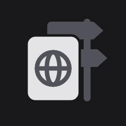

<div align="center">



# nrzDNS

**A self-hosted DNS server inspired by Technitium DNS Server, written in Rust.**

[Deutsch](docs/README.de.md) · [English](README.md)

</div>

nrzDNS answers the DNS queries of your whole network from one small program. It is authoritative for your own zones (`home.arpa`, `example.com`, reverse zones), sends everything else to the upstream servers you choose — classic UDP/TCP or encrypted over TLS and HTTPS — caches the answers, and blocks ads, trackers and malware with blocklists and your own rules. Every query lands in a searchable query log, and the dashboard shows what your devices are asking. Settings, zones, lists and the log live in one SQLite file. The web interface is a Rust/WebAssembly app (Dioxus) in a calm gray theme and also works on phones.

## Features

| | |
|---|---|
| **Authoritative zones** | Primary zones with SOA and NS, records of type **A, AAAA, CNAME, MX, TXT, NS, SRV, PTR and CAA**, **wildcards** (`*`, `*.dev`), disable single records or whole zones, comments. Every change raises the SOA serial. **Import and export** zone files in BIND format (RFC 1035). |
| **Conditional forwarding** | Forwarder zones send a domain to its own servers, e.g. `fritz.box` or `corp.example` to the router or a company DNS. Your own records in such a zone still win. |
| **Forwarding** | Upstream servers over **UDP** (with TCP fallback for truncated answers), **TCP**, **DNS over TLS** and **DNS over HTTPS**. Strategies: **sequential**, **random** or **parallel** (fastest answer wins). Presets for Cloudflare, Quad9, Google, AdGuard DNS and Mullvad. Health and response time per upstream. |
| **Cache** | Configurable size, minimum, maximum and negative TTL, **serve-stale** (RFC 8767) when no upstream answers, **prefetch** of popular entries shortly before they expire. Browse, search and flush the cache, all or by name. |
| **Blocking** | Blocklists in **hosts**, **plain domain** and **Adblock** (`\|\|ads.example.com^`) format, **presets** (StevenBlack, HaGeZi, OISD, AdGuard DNS filter), **automatic updates** every N hours, **pause** for a few minutes. Blocked names get `0.0.0.0`/`::`, `NXDOMAIN`, `REFUSED` or an address of your choice. "Is this domain blocked, and why?" check. |
| **Own rules** | **Blocked domains** and **allowed domains** of your own; each rule covers the domain and all its subdomains, and an allowed domain beats every block. |
| **Query log** | Every query with client, protocol, name, type, response code, source of the answer (zone, cache, upstream, blocked, local, dropped, failed), answer, duration and upstream. **Filters** for client, name, type, response code, source and time, **CSV export**, retention in days. |
| **Dashboard** | Totals, a **chart** over the last hour, day, week or month, **top clients, top domains, top blocked domains** and query types, server status with uptime, queries per second, cache size and upstream health. |
| **DNS client** | Ask this server (with zones, blocking and cache) or any other server over UDP, TCP, DoT or DoH, for any record type — with flags, answer, authority and additional sections. |
| **DoH endpoint** | nrzDNS itself answers **DNS over HTTPS** (RFC 8484) at `/dns-query`, `GET` and `POST`, and can be switched off. |
| **Protection** | **Rate limiting** per client (queries per second), private reverse lookups (`192.168.x.x`, `10.x.x.x`, `fc00::/7`, …) are not sent to the internet, optional empty answers for AAAA in networks without IPv6. |
| **Multi-user** | The **first account becomes the administrator**. **Admins** change everything; **members** see the dashboard, zones, lists, cache, log and DNS client but only change their own account. Registration can be opened or closed. |
| **Languages** | Deutsch and English |
| **One binary** | DNS engine, web server and web interface in one program (the interface is embedded at build time), one SQLite file, images and binaries for `linux/amd64` and `linux/arm64` |

## Quick start

You need Docker. The image contains the program and the web interface.

```bash
docker run -d --name nrzdns \
  -p 53:53/udp -p 53:53/tcp -p 8380:8380 \
  -v nrzdns-data:/data \
  ghcr.io/nicorenezweers/nrz-dns:1.0.0
```

The image is multi-arch (`linux/amd64`, `linux/arm64`) and is published for every [release](https://github.com/nicorenezweers/nrzDNS/releases). To build it yourself instead:

```bash
git clone https://github.com/nicorenezweers/nrzDNS.git
cd nrzDNS
docker build -t nrzdns .
```

Open <http://localhost:8380>. The first account you create becomes the administrator. After that, registration is closed until you open it in the settings, where you can also create accounts for others.

> **Port 53 must be free.** Only one DNS server can listen on it. Stop Pi-hole, AdGuard Home or dnsmasq first. On many Linux desktops `systemd-resolved` holds `127.0.0.53:53`; that is fine as long as nothing listens on `0.0.0.0:53`. If the port is taken, nrzDNS still starts and shows the error on the dashboard.

### Docker Compose

```yaml
services:
  nrzdns:
    image: ghcr.io/nicorenezweers/nrz-dns:1.0.0   # or: build: .
    container_name: nrzdns
    restart: unless-stopped
    ports:
      - "53:53/udp"
      - "53:53/tcp"
      - "8380:8380"
    volumes:
      - nrzdns-data:/data          # nrzdns.db: everything in one file
    environment:
      TZ: Europe/Zurich
      # NRZDNS_COOKIE_SECURE: "true"   # when the web interface is served via HTTPS
    sysctls:
      net.ipv4.ip_unprivileged_port_start: 0   # user 1000 may bind port 53
    cap_drop: [ALL]
    security_opt: [no-new-privileges:true]

volumes:
  nrzdns-data:
```

```bash
docker compose up -d
```

The container runs as user `1000` without any capabilities. Docker (20.10 and later) lets unprivileged users bind low ports inside a container anyway; the `sysctls` line makes that explicit.

> **Back up `/data`.** It holds `nrzdns.db` with everything in it (plus `nrzdns.db-wal` and `nrzdns.db-shm` while the server runs). Copy the whole folder, ideally while the container is stopped.

### Without Docker

Every [release](https://github.com/nicorenezweers/nrzDNS/releases) has the program for Linux (`amd64`, `arm64`) as a single file, with `SHA256SUMS`. It brings its own root certificates for DoT, DoH and blocklist downloads.

```bash
curl -LO https://github.com/nicorenezweers/nrzDNS/releases/download/v1.0.0/nrzdns-1.0.0-linux-amd64
chmod +x nrzdns-1.0.0-linux-amd64
sudo setcap 'cap_net_bind_service=+ep' nrzdns-1.0.0-linux-amd64   # allow port 53 without root
NRZDNS_ADDRESS=0.0.0.0 NRZDNS_PORT=8380 NRZDNS_DATA_DIR=./data ./nrzdns-1.0.0-linux-amd64
```

To try it without touching port 53, let it listen elsewhere, e.g. `NRZDNS_DNS_LISTEN=127.0.0.1:5353`, and ask it with `dig @127.0.0.1 -p 5353 example.com`.

### Both architectures

```bash
docker buildx build --platform linux/amd64,linux/arm64 -t <registry>/nrz-dns:1.0.0 --push .
```

Rust is cross-compiled, not emulated, so the arm64 build is fast on an x86 machine and vice versa. Only the program, gzipped per architecture (for the Umbrel app): `scripts/store-binaries.sh <folder>`.

## First steps

1. **Create your account**: the first one becomes the administrator.
2. **Choose upstream servers** (*Settings → Forwarding*): keep the default (Cloudflare and Quad9 over UDP) or pick a preset, e.g. Quad9 over DoH, and a strategy.
3. **Turn on blocking** (*Blocking*): add one or two preset lists, e.g. *HaGeZi Multi Normal*. They load immediately and update every 24 hours.
4. **Add your own names** (*Zones*): create a zone such as `home.arpa` and add `nas`, `printer` and friends as A records — or import an existing BIND zone file. For names your router knows (e.g. `fritz.box`), add a forwarder zone that points at the router.
5. **Point your network at nrzDNS** — see below.
6. **Watch it work**: the dashboard and the query log show every query; the DNS client answers "what does this name resolve to?".

## Using nrzDNS in your network

- **Whole network**: in your router's DHCP settings, set the DNS server handed to clients to the IP address of the machine running nrzDNS (e.g. `192.168.1.10`). Devices pick it up the next time they renew their lease (reconnect Wi-Fi or restart). Give that machine a fixed IP address first.
- **Single device**: set the DNS server in the device's network settings to that IP address.
- **Check**: `nslookup example.com 192.168.1.10` or `dig @192.168.1.10 example.com`; the query appears in the log.
- **DNS over HTTPS**: `https://<your-host>/dns-query` works for browsers and phones once the web interface is reachable via HTTPS (reverse proxy with a certificate); over plain HTTP it is useful for testing only.
- Keep a second DNS server out of the DHCP settings (or point it at another nrzDNS), otherwise devices bypass blocking and your local names whenever they like.

## Configuration

Start-up settings come from environment variables with the prefix `NRZDNS_` (or `Rocket.toml`). Everything about DNS itself is set in the web interface and takes effect immediately, without a restart.

| Variable | Default | Meaning |
|---|---|---|
| `NRZDNS_DATA_DIR` | `./data` (`/data` in the image) | Folder for `nrzdns.db` |
| `NRZDNS_PORT` / `NRZDNS_ADDRESS` | `8380` / `0.0.0.0` | Where the web interface, the API and `/dns-query` listen |
| `NRZDNS_DNS_LISTEN` | `0.0.0.0:53` | DNS socket addresses (UDP and TCP each), comma-separated, e.g. `0.0.0.0:53,[::]:53` |
| `NRZDNS_CONFIG` | `Rocket.toml` (`/app/Rocket.toml` in the image) | Path of the configuration file |
| `NRZDNS_COOKIE_SECURE` | `false` | Set to `true` when the web interface is served via HTTPS |
| `NRZDNS_IP_HEADER` | `X-Real-IP` | Header in which a reverse proxy passes the client address (login throttling); `false` when nrzDNS is reachable directly |
| `NRZDNS_LOG` | `info` | Log filter, e.g. `debug` or `info,nrzdns_engine=debug` |

### DNS settings (web interface, admins)

| Area | Defaults |
|---|---|
| General | Server name `ns.nrzdns.local` (SOA/NS of new zones), default TTL 3600 s, DoH on, rate limit off, private reverse lookups answered locally, AAAA answers on |
| Forwarding | Cloudflare `1.1.1.1` and Quad9 `9.9.9.9` over UDP, sequential, 2000 ms timeout per upstream |
| Cache | On, 50 000 entries, TTL between 10 s and 1 day, negative answers 300 s, serve-stale up to 1 day, prefetch on |
| Blocking | On, answer `0.0.0.0` / `::` with TTL 60 s, lists updated every 24 hours |
| Query log | On, kept for 30 days |

## Umbrel

nrzDNS is available in the community app store **nrzStore** (app `nrzDNS`, ID `nrz-dns`). The web interface opens on port `8400`; nrzDNS has its own login, so the Umbrel login in front of it is switched off. DNS is published on port `53` (UDP and TCP) of the Umbrel device, so:

- **Port 53 has to be free** on the device — don't run Pi-hole or AdGuard Home at the same time.
- Point your router's DHCP DNS setting (or single devices) at the **IP address of your Umbrel**.

Data lives in `app-data/nrz-dns/data`. The app ships the program for `amd64` and `arm64` inside the store and runs it in the official `debian:trixie-slim` image as user `1000`, without capabilities.

## Development

```bash
# backend (Rust 1.85+): server, DNS engine, shared types
NRZDNS_DNS_LISTEN=127.0.0.1:5353 cargo run   # web on http://localhost:8380, DNS on port 5353
cargo test --workspace
cargo clippy --workspace --all-targets -- -D warnings

# web interface with hot reload (dx = dioxus-cli 0.7)
rustup target add wasm32-unknown-unknown
cargo install dioxus-cli --version 0.7.10 --locked
cd ui && dx serve                 # http://localhost:8080, proxies /api and /static to :8380

# embed the interface into the program
scripts/ui.sh && cargo build --release
```

The workspace has three crates: `nrzdns` (the Rocket server, `src/`), `nrzdns-engine` (the DNS server itself, `engine/`) and `nrzdns-types` (every API type, `types/`, also used by the UI). The interface in `ui/` is its own project for `wasm32-unknown-unknown`. `scripts/ui.sh` builds it into `ui/dist/public`; `build.rs` embeds it (gzip) together with `locales/` and `static/`. Without it the server still runs and shows a notice instead of the interface. Translations live in `locales/<language>.json` (German source text → translation).

The JSON API lives under `/api/v1`; the endpoint table is the doc comment of [`types/src/lib.rs`](types/src/lib.rs). Architecture details: [ARCHITECTURE.md](ARCHITECTURE.md).

## License

AGPL-3.0-or-later. nrzDNS is an independent project inspired by [Technitium DNS Server](https://technitium.com/dns/) and shares no code with it. The UI components are based on [rust-ui](https://github.com/rust-ui/ui) (MIT), the font is [Inter](https://rsms.me/inter/) (OFL).
